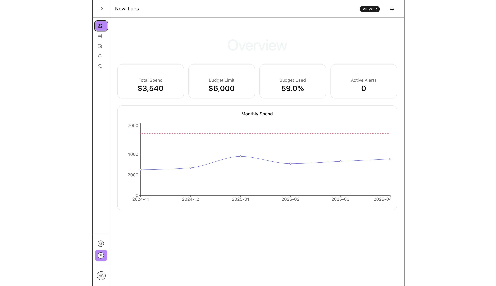

# Infra Watch

A multi-tenant infrastructure spend tracking dashboard built as a portfolio project.

Organizations monitor cloud service costs across providers like AWS, Vercel, and Render — tracking monthly spend against configurable budgets with a tiered alert system that fires when spend thresholds are crossed.



---

## Features

- **Multi-tenancy** — users belong to multiple organizations with independent data, roles, and budgets. Switching orgs updates all data instantly via scoped cache keys.
- **Spend tracking** — monthly spend per service visualized as a time series chart with a budget reference line and per-service sparklines.
- **Tiered alerts** — configurable INFO / WARNING / ALERT thresholds (percentage-based) that fire when org spend exceeds the configured level, with per-alert notification recipients.
- **Role-based access** — ADMIN / MEMBER / VIEWER roles per org membership, reflected in the UI.
- **Services table** — per-service spend breakdown with provider badges, current month cost, percentage of total, and 6-month trend sparklines.

---

## Stack

| Layer         | Technology                   |
| ------------- | ---------------------------- |
| Framework     | React 19 + TypeScript        |
| Build         | Vite                         |
| Routing       | TanStack Router (file-based) |
| Server state  | TanStack Query               |
| Client state  | Zustand                      |
| UI components | shadcn/ui + Radix primitives |
| Styling       | Tailwind CSS v4              |
| Charts        | Recharts                     |

**Planned backend:** Node.js · Fastify · Prisma · PostgreSQL · GraphQL

---

## Architecture

The frontend follows a feature-sliced structure — domain logic lives in `src/features/`, shared UI in `src/components/`, and layout in `src/layouts/`. Each feature owns its query hooks, API functions, and types independently.

```
src/
  features/
    dashboard/     # Overview page — stat cards, spend chart
    services/      # Services table with sparklines
    alerts/        # Alert configuration and fired state
    budget/        # Budget management
    members/       # Org membership and roles
  layouts/         # AppShell, Sidebar, TopBar
  store/           # Zustand — session, current org, UI state
  lib/             # QueryClient, router, query key registry
  data/            # Static seed data (replaces backend)
  types/           # Domain interfaces matching the data model
```

**Server state** is managed by TanStack Query with org-scoped cache keys (`['services', orgId]`). Switching organizations invalidates all queries and refetches for the new org — zero cross-org data leakage.

**Client state** (current user, current org, sidebar) lives in Zustand. Zustand drives which org Query fetches for, making the two libraries complementary rather than overlapping.

---

## Data Model

```
Organization ──< OrgMembership >── User
     │
     ├──< Budget    (percentage-based alert thresholds)
     ├──< Alert     (INFO / WARNING / ALERT, notifies users)
     └──< Service
              └──< SpendEntry   (amount, date, billingPeriod)

enum Role       = ADMIN | MEMBER | VIEWER
enum AlertType  = INFO | WARNING | ALERT
enum Provider   = AWS | VERCEL | RENDER
```

---

## Getting Started

```bash
git clone https://github.com/your-username/infra-watch
cd infra-watch
npm install
npm run dev
```

The app runs on static seed data — no backend required. Three organizations are pre-loaded (Acme Systems, Nova Labs, Drift) with realistic spend patterns, shared users across orgs, and alerts in various fired states.

---

## Roadmap

- [ ] Budgets page — create, edit, delete budgets per org
- [ ] Backend — Fastify + Prisma + PostgreSQL
- [ ] GraphQL API layer
- [ ] Authentication — JWT via httpOnly cookies
- [ ] Real-time alert notifications
